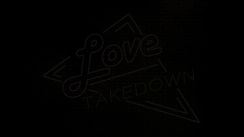

# Love Takedown

> *The night... the neon... and the adrenaline!*

You're leaving the Love Takedown club, the bass still pounding in your veins, and a faceless horde is about to close in on you. Your only way out is your legs, your fists, and the taxi picking you up in two very long minutes.

🎮 **[Play it on itch.io](https://antoinearzac.itch.io/love-takedown)**

> ⚠️ **Content warning:** this game contains scenes evoking street harassment.

## Gameplay

- **Book a ride.** Order a taxi from your phone, then survive until it arrives.
- **Run.** The crowd keeps coming and chasing you. Some of them sprint in bursts when they get close. Each hit you take brings the camera closer and narrows your view.
- **Watch the signal.** The phone shows the taxi's route, but the connection drops in dead zones. Find a spot with good reception to keep track of it.
- **Take them down.** Being surrounded builds adrenaline. When the gauge is full, unleash a **Takedown** and send everyone around you flying for a few seconds.
- **Make it to the taxi.** It only waits a few seconds. Miss it and it's game over.

## Controls

| Action | Keyboard / Mouse | Gamepad |
| --- | --- | --- |
| Move | `W` `A` `S` `D` | Left stick |
| Sprint (short burst, with a cooldown) | `Shift` | Right trigger |
| Book ride / Takedown | Left click | `A` |
| Show / hide phone | `↑` / `↓` | D-pad up / down |

## Running the project

- **Engine:** Unity `6000.0.26f1` with URP, Cinemachine and the Input System
- Open the project in Unity Hub and start from `Assets/Scenes/Menu.unity`.
- Gameplay scripts are in `Assets/Scripts/` (Player, Enemy, Phone, Taxi, Audio, Menu, Manager).

## Credits

Made in 72h for **Game Jam #20 – "Random Title Jam"** by Game Dev Party, a non-profit that promotes indie games in the Rhône-Alpes region, held at Gaming Campus, Lyon.
Randomly generated theme: *Wrath of the love takedown*.

| | |
| --- | --- |
| Mike Dutertre | 3D art |
| Hugo Ettlin | Tech art |
| Lucas Lemoine | Sound design |
| Hugo Lesec | Dev |
| Jocelyn Renault | Dev |
| Antoine Arzac | Game design |

Thanks to the Game Dev Party organizers for hosting us and for their dedication during the 72 hours of the jam, and to Gaming Campus for lending us their space.
